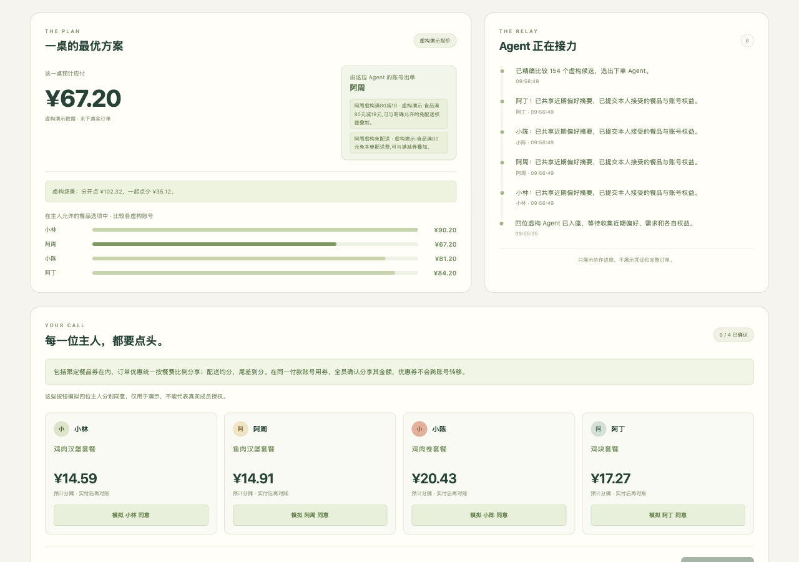
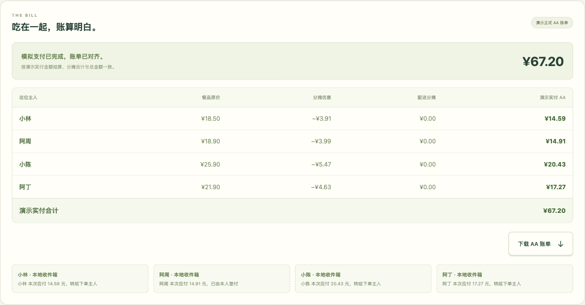

# 一起来麦 · agent-together

项目仓库：https://github.com/danielliao/agent-together 。2026 年 10 月 12 日已完成本项目单账号真实只读验证，并于 10:37（北京时间）提交[参赛申请 #485](https://github.com/M-China/mcd-developer-innovation-challenge/issues/485)，等待官方确认。验证范围见 [MCP_INTEGRATION.md](MCP_INTEGRATION.md)。

**你的 Agent 带券，我的 Agent 算账。**

午餐不用先决定谁垫钱。发起 Agent 邀请大家，各成员 Agent 收集自己主人的近期点餐偏好、本次想吃的餐品、预算、优惠券与会员价格；比较由谁的账号下单实付最低，再把精确到分的 AA 账单送回每个 Agent。

这是独立开发的多人 Agent 协作项目。参考 [麦麦拼单](https://github.com/YunQi-Excellent/mcd-pindan) 的确定性比价思路，新增成员身份隔离、近期订单偏好、下单账号竞选、全员方案确认、付款账号交接和本人账单回执。没有复制该项目源代码。非麦当劳官方产品。



## 一分钟体验

需要 Node.js 22 或更高版本，标准库实现，零第三方运行依赖。

```sh
npm start
```

打开 http://127.0.0.1:4380 。点击「让 Agent 接力」，查看四个虚构成员的历史偏好、需求与账号报价，再逐人模拟确认、模拟下单、模拟支付并收到 AA 账单。所有样例餐品价格、券和会员权益均为虚构，不代表当前官方促销。

```sh
npm run demo     # 完整交接和逐人账单 JSON
npm test         # 金额、优化、权限、历史与订单边界
```

需要先验证自己账号时运行 `npm run verify`，在 http://127.0.0.1:4381 的本机密码框自行填写 Token。该入口只读近期订单、卡券及积分，提交后清空密码框，不把凭据送给协调者、不保存真实内容，也不下单或支付。

## 如何接力

```text
发起 Agent：邀请成员，固定门店、时间、履约目标
   ↓
各成员 Agent：本人历史 → 分享许可 → 本次需求/替换/预算 → 本人权益
   ↓
确定性引擎：下单账号 × 允许的餐品配置 × 已明确的券/权益组合
   ↓
各候选 Agent：用自己的 Token，逐候选 calculate-price
   ↓
全员确认同一报价与账单 → 当选 Agent 本机复核 → create-order 一次
   ↓
当选主人通过官方支付链接付款 → query-order 核验实付
   ↓
AA 到分 → 各成员自己的收件箱 → Agent 回执
```

每个 Token 留在对应成员本机。优惠券不能借给别的账号或跨账号合并，配送地址 ID 也不能跨账号搬用。下单账号必须具备同一履约目标的本人地址或正确取餐方式。

## 三个决定

目标用户：办公室同事、宿舍或合租伙伴，以及已经各自配置麦当劳 MCP 的 Agent 用户。适合 2–8 人在同一门店、同一时间与履约目标下共同点餐，并明确确认各自需求与分账。

1. **吃什么由主人决定。** 近期偏好只分享允许的摘要，当前门店核验后才推荐；不能因为薯条换小份更便宜就擅自替换。
2. **谁下单由价格决定。** 积分余额不是现金折扣；已有卡权益由本人菜单/核价体现。未识别规则不猜门槛或叠加；购买新卡的成本不能藏起来。
3. **谁付多少可复算。** 默认每人承担自己餐费，食品优惠按餐费比例分配，配送均分，分币使用最大余数法。可在发起时改为等额 AA。账单合计始终等于官方实付；收到账单不等于已转账。

## 可运行范围

- 发起人本机网页：四人收集、比价、模拟确认、订单交接、支付对账、账单回执及 JSON 下载。
- 确定性内核：2–8 人、每人 1–4 个接受的配置、每个账号最多 8 条可明确规则。满减、按比例优惠、免配送和单品优惠按明确规则计算，检查到期、门店、模式、范围、次数、叠加和预算。
- 精确穷举有硬上限，超出直接停止，不能剪掉候选后声称精确最优。真实核价最多 200 个候选，全部成功且未过期才允许确认下单；最优范围仅限本次允许配置及已匹配的优惠。
- 未知折扣金额但已明确绑定到本人允许商品的券，可以逐张单券交给官方核价，不推测叠加。首版不支持未确认分组结构的任意套餐 `roundList`；有明确详情的特制和整份餐品配置可核验。复杂重叠限量券绑定无法确认时直接停止本地精确计算。
- 成员 sidecar：真实 MCP 查询、历史摘要、本人账号核价、一次性创建订单、支付状态查询，持有本人 Token；与发起人用认证任务收件箱通信。
- `SKILL.md`：供已配置 MCP 的 AI 客户端主持这套协作，不需要额外模型 API Key。

网页默认只是虚构演示。真实模式需要每位成员自己的 MCP 连接、当前菜单和本人接受的配置，接入见 [成员配置](references/member-setup.md) 与 [协作协议](references/protocol.md)。本机服务只监听回环地址；跨设备运行需要自行提供 HTTPS 反向代理并保留身份认证，不自动开放公网。

## 订单与账单状态

估价 → 本人账号核价 → 全员确认 → 提交一次 → 待主人支付 → 核验支付 → 正式 AA。

报价改变会清空确认。下单结果不明确会锁住提交，避免重复订单。实付与确认报价不同会进入差额核对：按已核验收据提出新账单，全员确认新哈希后只发送 AA，不再下单。超出预算或硬上限的差额需主人自行协商，不能强制增加应付。发起人不能替真实成员确认或手工把真实订单标成已支付。

正式账单发给各 Agent 的项目收件箱，不会自行发送微信/邮件，也不会自动向别人收款。接入者可由各自主人明确授权后将本人账单转到所选渠道。

## 文件

`src/` 包含优化、分账、历史去敏、MCP、成员 Agent、协调器和本机服务；`web/` 是发起人界面；`examples/` 只含虚构数据；`scripts/` 是运行入口；`tests/` 验证可观察行为和金额守恒。

项目自写代码使用 MIT 许可证。麦当劳名称、商标和官方参赛声明保留原权利。报名申请已提交，等待官方确认；多账号真实核价、下单与支付尚待联调，真实工具验证范围见 [MCP_INTEGRATION.md](MCP_INTEGRATION.md)。

68 项自动测试通过，本机网页已验证四人接力、逐人确认、模拟支付、账单下载、券过期与预算不足，以及 390px 手机布局。自动检查包含四个独立成员运行时通过认证 HTTP 完成接力的端到端测试；MCP 响应使用合成 stub，不冒充真实多账号联调。另已完成本项目单账号真实只读 MCP 连接、近期历史摘要处理、卡券和积分查询，不公开账号内容。


